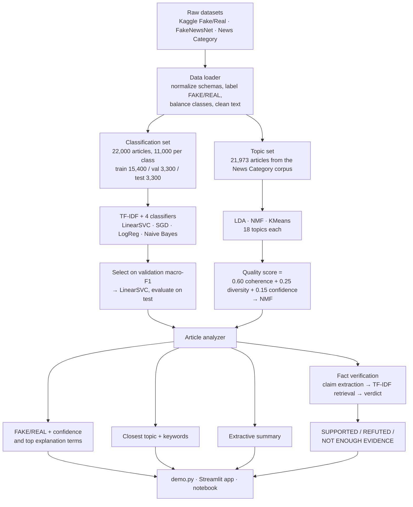
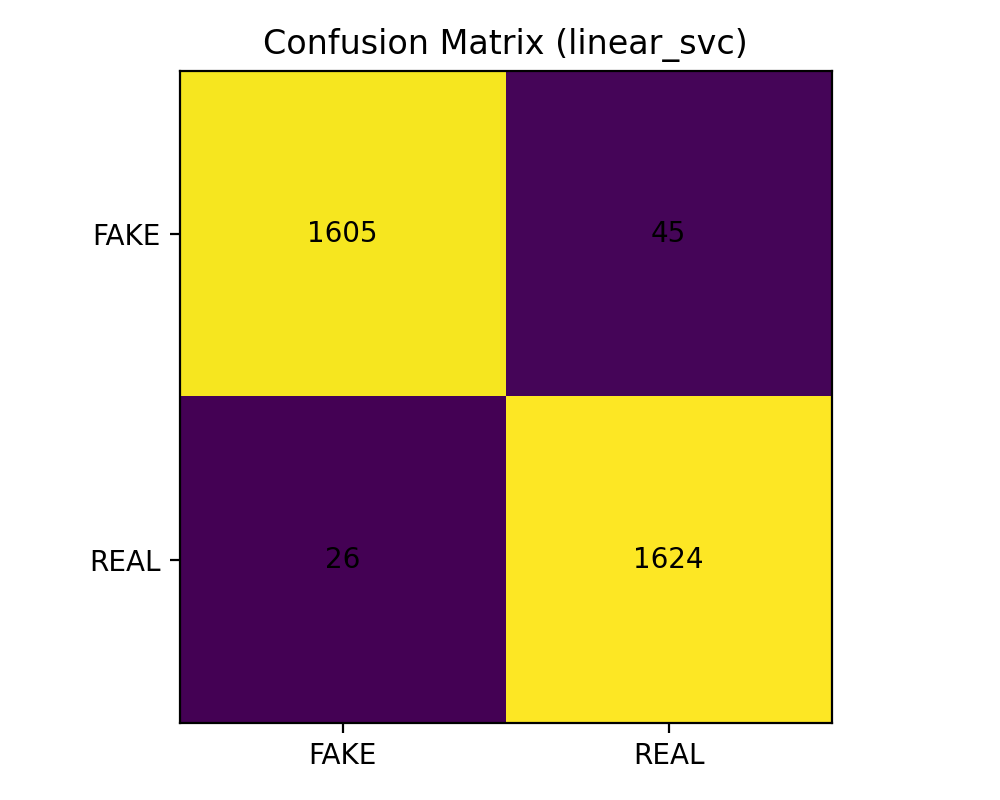
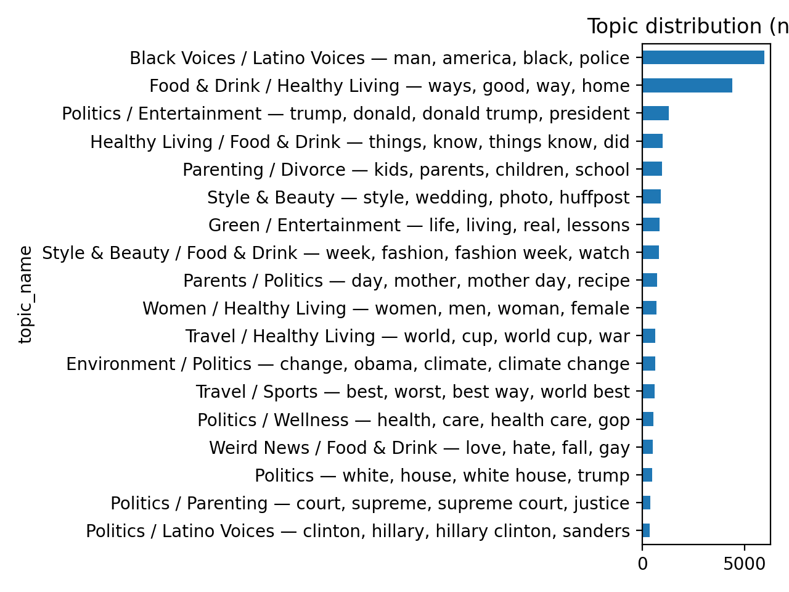

# News Intelligence Studio

An end-to-end NLP system for news analysis. Given an article, it predicts whether it looks **FAKE or REAL**, finds its closest **topic**, writes an **extractive summary**, and runs **claim-level fact verification** against retrieved evidence. Final project for CS6120 Natural Language Processing (Northeastern University, Spring 2026), Team 116.

## Results at a glance

| Task | Approach | Result (held-out test set unless noted) |
|---|---|---|
| Fake vs. real classification | TF-IDF (1–2 grams, 9,000 features) + LinearSVC, chosen from 4 models on validation macro-F1 | **97.85% accuracy, 0.978 macro-F1** on 3,300 test articles (balanced) |
| Topic discovery | LDA vs. NMF vs. KMeans, scored on coherence, topic diversity and confidence | **NMF selected**, quality score **0.77** vs. 0.61 (KMeans) and 0.40 (LDA), 18 topics over 21,973 articles |
| Summarization | Word-frequency sentence scoring with a position bonus | 3-sentence extractive summaries, no large model needed |
| Fact verification | Claim extraction → TF-IDF evidence retrieval → overlap + negation scoring | SUPPORTED / REFUTED / NOT ENOUGH EVIDENCE per claim |

All numbers come from the saved outputs in [`results/`](results/) (`classification_metrics.json`, `model_benchmark.csv`, `topic_model_benchmark.csv`, `dataset_overview.json`).

## Architecture



## Team and contributions

| Member | Primary responsibility |
|---|---|
| **Chaman Kumar** | Topic-modeling research, LDA / NMF / KMeans comparison, theme label review |
| **Satyam Priyam** | Data preparation, preprocessing, classification experiments, benchmark outputs |
| **Killol Rajgor** | Project integration, notebook and demo workflow, report and presentation |
| Shared | Debugging, verification extension, benchmark decisions, final documentation |

## Datasets

The datasets are **not included** in this repository (size and licensing). Download them from their original sources and place them at these paths:

| Dataset | Rows | Role | Path |
|---|---|---|---|
| [Fake and Real News Dataset (Kaggle)](https://www.kaggle.com/datasets/clmentbisaillon/fake-and-real-news-dataset) | 44,898 | Primary fake/real signal | `data/raw/kaggle_fake_real/Fake.csv`, `True.csv` |
| [FakeNewsNet (BuzzFeed + PolitiFact)](https://github.com/KaiDMML/FakeNewsNet) | 422 | Extra article styles | `data/raw/fakenewsnet/*_news_content.csv` |
| [News Category Dataset v3 (Kaggle)](https://www.kaggle.com/datasets/rmisra/news-category-dataset) | 209,527 | Topic modeling and extra REAL articles | `data/raw/news_category/News_Category_Dataset_v3.json` |

## 1. Fake vs. real classification

**Data.** 22,000 articles, balanced 11,000 FAKE / 11,000 REAL (18,369 from Kaggle, 3,488 extra REAL from News Category, 143 from FakeNewsNet), split 15,400 / 3,300 / 3,300.

**Model selection.** Every candidate uses the same TF-IDF features (`ngram_range=(1, 2)`, `max_features=9000`, `min_df=4`, `sublinear_tf=True`, English stop words). The model with the best **validation** macro-F1 is chosen; speed is reported but not used to choose.

| Model (validation set) | Accuracy | Macro-F1 | Train time | Predict time / article |
|---|---|---|---|---|
| **LinearSVC** (selected) | **97.61%** | **0.976** | 12.2 s | 0.25 ms |
| SGD (log loss) | 97.33% | 0.973 | 11.4 s | 0.24 ms |
| Logistic Regression | 97.18% | 0.972 | 11.3 s | 0.24 ms |
| Multinomial Naive Bayes | 85.27% | 0.852 | 11.4 s | 0.23 ms |

**Test result (selected model):** 97.85% accuracy, 0.978 macro-F1 on 3,300 held-out articles.

| Confusion matrix (test) | Predicted FAKE | Predicted REAL |
|---|---|---|
| **Actual FAKE** | 1,605 | 45 |
| **Actual REAL** | 26 | 1,624 |

**By source (test):** Kaggle 98.19% on 2,762 articles; News Category REAL articles 96.35% on 520; FakeNewsNet 88.89% on only 18 articles.



## 2. Topic modeling

Three unsupervised approaches were trained on the same 21,973 articles with 18 topics each, and scored on the same three measures:

- **Coherence proxy:** how often each topic's top words actually co-occur in documents (term co-occurrence).
- **Topic diversity:** unique top words divided by all top-word slots (higher means less repetition across topics).
- **Average topic confidence:** how strongly documents are assigned to their top topic.

Each measure is min-max normalized across the three models, then combined as **quality = 0.60 × coherence + 0.25 × diversity + 0.15 × confidence**, so coherence and diversity matter more than confidence or runtime.

| Model | Vectorizer | Coherence proxy | Diversity | Quality score | Train time |
|---|---|---|---|---|---|
| **NMF** (selected) | TF-IDF, 4,200 features | −3.28 | 0.91 | **0.77** | 3.6 s |
| KMeans | TF-IDF, 4,200 features | −3.28 | 0.76 | 0.61 | 4.1 s |
| LDA | counts, 3,200 features | −4.10 | 0.98 | 0.40 | 19.8 s |

**Why NMF won:** it matched KMeans on coherence while producing much more distinct topics, and LDA's very diverse topics were far less coherent (and LDA was about 5× slower). Example NMF topics (top words):

| Topic | Top words |
|---|---|
| 2 | clinton, hillary, sanders, bernie, campaign |
| 8 | health, care, health care, mental health, obamacare |
| 10 | kids, parents, children, school, family |
| 14 | court, supreme court, justice, decision, law |
| 17 | climate change, obama, president, barack |

All 18 topics, with keywords, categories and representative titles: [`results/topic_keywords.csv`](results/topic_keywords.csv), [`results/topic_representative_titles.csv`](results/topic_representative_titles.csv).



## 3. Summarization

Sentences are scored by the sum of their normalized word frequencies (stop words removed) plus a small bonus for appearing early in the article, then the top 3 are returned in their original order. It's fast and deterministic, with no large language model. Examples: [`results/sample_summaries.csv`](results/sample_summaries.csv).

## 4. Fact verification

1. **Claim extraction:** split the article into sentences and keep claim-like ones (heuristics in `fact_verify/claim_extractor.py`).
2. **Evidence retrieval:** TF-IDF (1–2 grams) over a local evidence corpus; top-k passages by cosine similarity.
3. **Verdict:** score = 0.65 × lexical overlap + 0.35 × retrieval similarity, with a contradiction signal when negation differs between claim and evidence. **REFUTED** if the contradiction score is at least 0.42 and clearly above support; **SUPPORTED** if support is at least 0.40; otherwise **NOT ENOUGH EVIDENCE**.

This is a transparent lexical baseline, not a trained natural-language-inference model; see Limitations.

## Run it

```bash
python -m venv .venv
source .venv/bin/activate
pip install -r requirements.txt

python demo.py                 # train/select models and run the full analysis demo
streamlit run streamlit_app.py # interactive UI
pytest                         # unit tests
```

Trained artifacts are included in [`models/`](models/). The notebook walkthrough is in [`notebooks/demo.ipynb`](notebooks/demo.ipynb) (an executed copy is `notebooks/demo_executed.ipynb`). Detailed usage, outputs and troubleshooting: [`docs/USAGE.md`](docs/USAGE.md).

## Project structure

```text
src/            data loading, preprocessing, training and model selection, analyzer, summarizer
fact_verify/    claim extraction, evidence retrieval, verdict logic
models/         trained classifier and topic-model artifacts
results/        metrics, benchmarks, predictions, topic outputs, figures
notebooks/      notebook demo (plus an executed copy)
tests/          unit tests (pytest)
docs/USAGE.md   detailed usage guide
demo.py, streamlit_app.py, train_pipeline.py
```

## Limitations

- **Source cues inflate accuracy.** Many REAL articles in the Kaggle dataset carry publisher patterns (e.g. "WASHINGTON (Reuters)"), so a bag-of-words model can partly learn the source rather than the content. Accuracy drops on out-of-domain sources (FakeNewsNet: 88.89%, but on only 18 test articles).
- **Topic quality uses a coherence proxy**, not a standard measure such as C_v or NPMI, and the quality-score weights are a project choice.
- **Fact verification is lexical.** It catches overlap and negation, not paraphrase or entailment; a trained NLI model would be the natural next step.
- **Single run.** Results come from one fixed split and random seed (42).

## Acknowledgements

Built for CS6120 Natural Language Processing at Northeastern University (Spring 2026). Datasets belong to their respective authors; see the links above.
